  

   
  
  
  

 

<h3 align="center">I build systems that see clearly, survive attacks, and stay online.</h3>

我做的系统：看得清 · 扛得住 · 跑得稳

01 Focus&nbsp;&nbsp;·&nbsp;&nbsp;02 Toolbox&nbsp;&nbsp;·&nbsp;&nbsp;03 Principles&nbsp;&nbsp;·&nbsp;&nbsp;04 Activity&nbsp;&nbsp;·&nbsp;&nbsp;05 Connect

---

## 01 — What I do 我做什么

<table>
  <tr>
    <td width="34%" valign="top">
      
        
      <b>COMPUTER VISION</b> 
      机器视觉
        
      Detection, tracking and measurement pipelines — from camera to decision, on a latency budget you can defend.
        
      从相机到决策的检测、跟踪与量测管线，延迟可控。
    </td>
    <td width="33%" valign="top">
      
        
      <b>CYBERSECURITY</b> 
      网络安全
        
      Offensive tooling and defensive hardening — one system, studied from both sides until it holds.
        
      攻击面分析与加固，从两侧审视同一个系统。
    </td>
    <td width="33%" valign="top">
      
        
      <b>DEVOPS</b> 
      运维
        
      Containerized delivery, CI/CD and observability — infrastructure boring enough to forget.
        
      容器化交付、CI/CD 与可观测性，无聊到可以忽略的基础设施。
    </td>
  </tr>
</table>

## 02 — Toolbox 工具链

**LANGUAGES**

**VISION**

**SECURITY**

**OPERATIONS**

## 03 — How I work 工作方式

**01 · Measure before optimizing** 先测量，再优化 
A latency budget is a contract, not a wish. Profile first, then cut.

**02 · Assume breach** 假定已被攻破 
Design for detection and recovery — prevention alone is a bet you eventually lose.

**03 · Automate the third time** 第三次就自动化 
The third manual run is a bug in the process, not a task on the list.

## 04 — Activity 活跃度

  

Live from GitHub · 数据实时同步

## 05 — Connect 联系

  
  

Open to collaboration on vision, security and infrastructure. · 欢迎在视觉、安全与基础设施方向交流合作。

---

SEE · DEFEND · RUN

